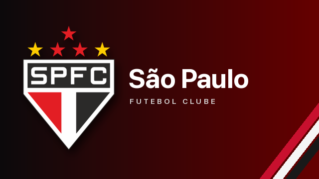
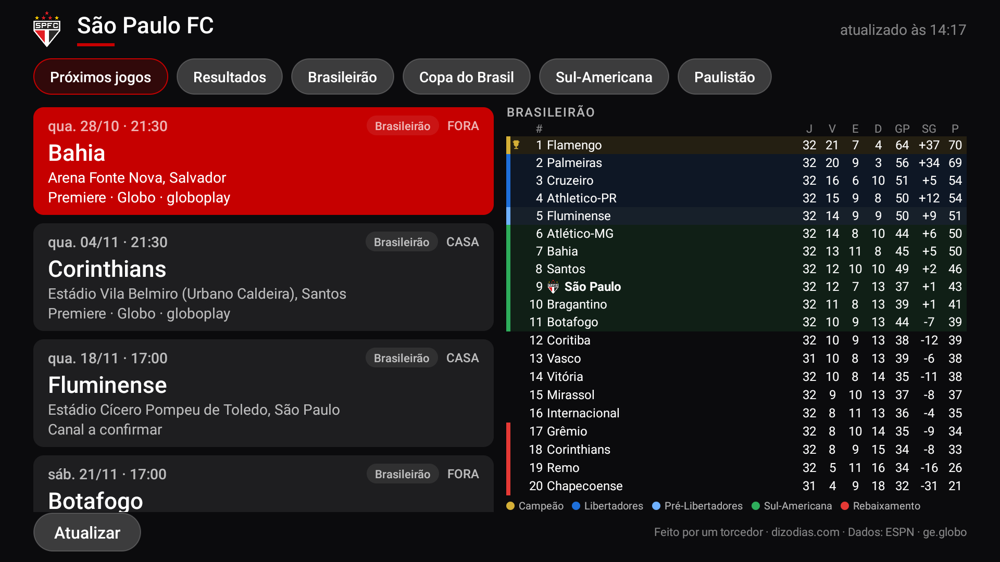
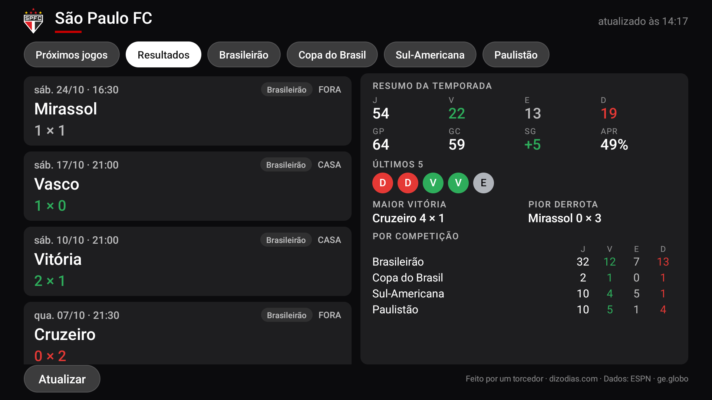

<p align="center"></p>

# São Paulo FC para Fire TV

> Um projeto de fã, feito com amor e carinho por um torcedor do São Paulo Futebol Clube. 🔴⚪⚫
> Sem nenhum vínculo com o clube e sem fins comerciais. O escudo e o nome são marcas do São Paulo FC.

Um app nativo para Fire TV / Android TV que mostra, em tela cheia e otimizado para controle remoto:

- **Próximos jogos do Tricolor**, com data, horário, mandante/visitante, estádio, canal e a competição.
- **Resultados** da temporada, com placar em verde, cinza ou vermelho, e um **resumo** ao lado: V/E/D, gols, aproveitamento, últimos 5 jogos, maior vitória, pior derrota e números por competição.
- **Uma aba por competição** em que o São Paulo jogou no ano (Brasileirão, Copa do Brasil, Sul-Americana, Paulistão…).
- **Tabela do Brasileirão** inteira (20 times, sem rolagem), com o campeão em dourado, as faixas da Libertadores, da pré-Libertadores e da Sul-Americana, o Z-4 destacado, uma legenda e o São Paulo em evidência.
- Um banner próprio na tela inicial da TV.





## Técnica
- Java puro e Android SDK, `minSdk 25`, roda no Fire OS 6 (Fire TV Stick 4K de 2018).
- Agenda e tabela: API pública da ESPN (`site.api.espn.com`), sem chave.
- Canais de TV: ESPN, depois a agenda do ge.globo, depois o override manual em [`data/canais.json`](data/canais.json) no raw do GitHub. Se ninguém souber, o card mostra “Canal a confirmar”.
- Rede fora da UI thread e navegação 100% por D-pad.

## Instalar
Baixe o APK em **Releases** e instale com `adb install spfc-firetv.apk`, ou use o app Downloader na TV.

## Compilar
```sh
./gradlew assembleDebug
```

Vamos, São Paulo!
